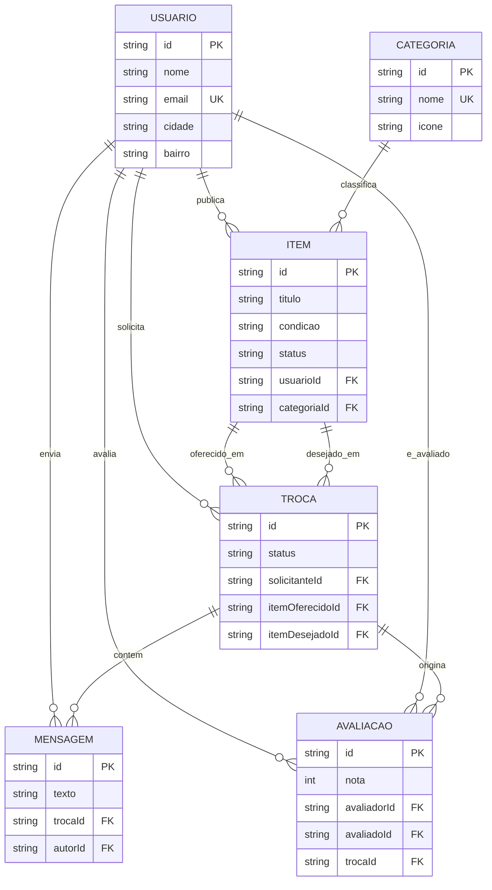

# Modelo de dados — ReUse! Web

## Diagrama entidade-relacionamento (Mermaid)

## Descrição das tabelas

| Tabela       | Objetivo                                                                 |
|--------------|-----------------------------------------------------------------------------|
| `usuarios`   | Armazena as pessoas cadastradas na plataforma (nome, contato, localização). |
| `categorias` | Organiza os itens por tipo (Eletrônicos, Livros, Móveis, etc.).            |
| `itens`      | Objetos disponíveis para troca ou doação, vinculados a usuário e categoria. |
| `trocas`     | Propostas de troca entre dois usuários, envolvendo dois itens.             |
| `mensagens`  | Histórico de conversas trocadas dentro de uma proposta de troca.           |
| `avaliacoes` | Notas e comentários que um usuário dá a outro após uma troca concluída.    |
